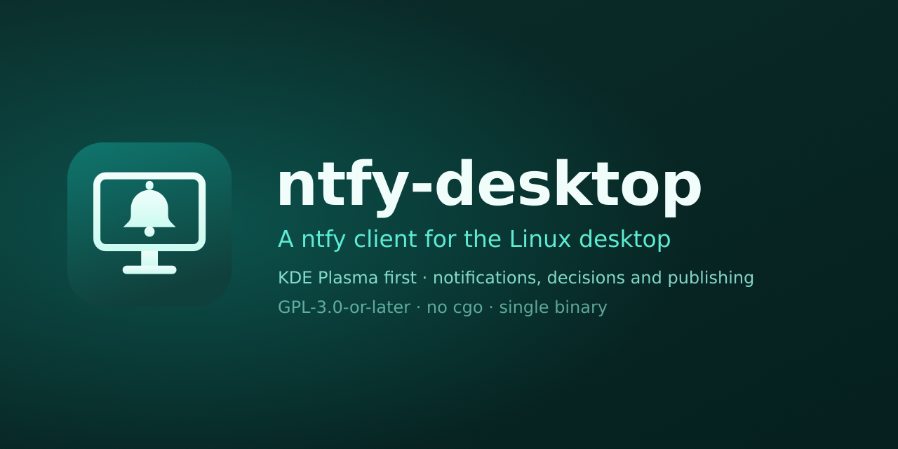

# ntfy-desktop



An [ntfy](https://ntfy.sh) client for the Linux desktop.

ntfy has a web app, a mobile app and a CLI — but no desktop client for Linux. This project is
that client: it subscribes to a topic, shows what arrives as native notifications, lets you act
on messages from a desktop dialog, and publishes messages back.

**Status: pre-release.** It subscribes to a topic, shows what arrives as native notifications and
asks for decisions through the desktop's own dialog. It runs with the graphical session as a user
service. History and publishing are not there yet. See the [roadmap](#roadmap).

## What it does

- Subscribes to an ntfy topic over the JSON stream, and reconnects with a growing wait when the
  server goes away.
- Shows each message as a native desktop notification, with the urgency that matches its priority.
- Opens a desktop dialog for messages that carry actions, one at a time, and runs the chosen
  action: open its link or call its URL.
- Runs as a daemon from the graphical session, so messages arrive without a terminal open.

## Platforms

| Desktop | Status |
|---|---|
| KDE Plasma and derivatives (Kubuntu, KDE neon) | first target |
| GNOME and derivatives (Ubuntu, Fedora Workstation) | scaffolded, not implemented |
| Others (XFCE, Cinnamon, Sway) | out of scope for now |

The client does not link Qt or GTK. It delegates dialogs to the desktop's own tool — `kdialog`
on Plasma, `zenity` on GNOME — and detects which one to use at startup. One build, native look
where it runs.

## Requirements

- Linux, with a graphical session.
- Nothing else: the Go toolchain lives inside the repository and the binary is built without
  cgo, so there are no shared library dependencies.

On KDE, dialogs need `kdialog`, which ships with `kde-cli-tools` — a dependency of
`plasma-desktop`, so it is already there on any Plasma install.

## Build from source

```sh
git clone https://github.com/maurorosero/ntfy-desktop
cd ntfy-desktop

make bootstrap     # downloads go1.27.4 into .toolchain/ and verifies its sha256
make check         # gofmt + vet + tests + build
```

No Go installation is needed: `make` uses the toolchain inside the repository.

## Run

```sh
./bin/ntfy-desktop                      # prints the detected environment
./bin/ntfy-desktop --version            # prints the version
./bin/ntfy-desktop --daemon             # subscribes until it is stopped
./bin/ntfy-desktop daemon --log-level debug   # same, with debug logging
```

With no arguments it prints what it detects about the session and exits:

```sh
ntfy-desktop 0.0.1
  user       mrosero
  locale     es_PA
  desktop    kde
  dialogs    /usr/bin/kdialog
```

`--daemon` is the mode the service unit starts. It reads the configuration, subscribes, shows what
arrives and asks for decisions, and stays in the foreground so systemd can supervise it: the log
goes to stderr, which is the journal. `SIGTERM` and `SIGINT` end it in well under a second, and any
dialog it opened is killed with it.

The log level is `info` unless `--log-level` or the `log-level` key says otherwise
(`debug`, `info`, `warn`, `error`); the flag wins over the file.

## Run with the session

`packaging/ntfy-desktop.service` is a user unit: it starts with the graphical session, restarts the
client if it aborts, and leaves a journal behind.

```sh
install -Dm644 packaging/ntfy-desktop.service ~/.config/systemd/user/ntfy-desktop.service
systemctl --user daemon-reload
systemctl --user enable --now ntfy-desktop.service
journalctl --user -u ntfy-desktop -f
```

A packaged install puts the same file in `/usr/lib/systemd/user/`. A daemon that cannot read its
configuration exits with status 1 and says why in the journal; systemd retries a few times and then
gives up instead of looping.

## Configuration

One file, written by you — a package never puts anything in your home:

```
$XDG_CONFIG_HOME/ntfy-desktop/config.toml      # normally ~/.config/ntfy-desktop/config.toml
```

```toml
server    = "https://ntfy.example.org"   # required, http or https, no query, no fragment
topic     = "alerts"                     # required: 1 to 64 of [A-Za-z0-9_-]
user      = "andrea"                     # optional, together with password
password  = "…"                          # optional, together with user
log-level = "info"                       # optional: debug, info, warn or error
```

Leave `user` and `password` out to subscribe to a public topic; set both to use HTTP Basic on a
protected one. Half a pair is a configuration error, not an anonymous subscription: the loader
says which key is missing instead of quietly connecting without credentials.

`log-level` is what the daemon logs at when `--log-level` is not given; the flag wins.

The loader and its validation live in `internal/config`; comments, blank lines and one
`key = \"value\"` per line are supported, with `\"`, `\\`, `\n`, `\t` and `\r` escapes. Any other key
is an error, so a typo is never silently ignored.

## Project layout

```
cmd/ntfy-desktop/     entry point
internal/config/      configuration loading and validation
internal/ntfy/        ntfy protocol: JSON stream, authentication, reconnection
internal/notify/      desktop notifications over the freedesktop D-Bus service
internal/platform/    session user, locale and desktop detection
internal/version/     version injected at build time
assets/               icon (SVG + PNG) and banner
packaging/            .desktop file and systemd user unit
plan/                 scope, milestones and design decisions
tools/                Go toolchain bootstrap and git hooks
```

## Roadmap

Full scope, milestones and acceptance criteria live in [`plan/alcance.md`](plan/alcance.md)
(written in Spanish). In short:

1. Read: connect and subscribe. — done
2. Notify: one notification per message. — done
3. Decide: actions, dialog, queue. — done
4. Resilience: reconnect, catch up, start with the session. — done
5. History. — next
6. Publishing.
7. Portability: verify the GNOME adapter on a real machine.

## Contributing

See [`CONTRIBUTING.md`](CONTRIBUTING.md). Contributions are accepted under the Developer
Certificate of Origin (`git commit -s`).

## Security

See [`SECURITY.md`](SECURITY.md) for how to report a vulnerability privately.

## License

GPL-3.0-or-later. See [`LICENSE`](LICENSE) and [`NOTICE`](NOTICE).

ntfy is a separate project by Philipp C. Heckel. This client is not affiliated with it.
